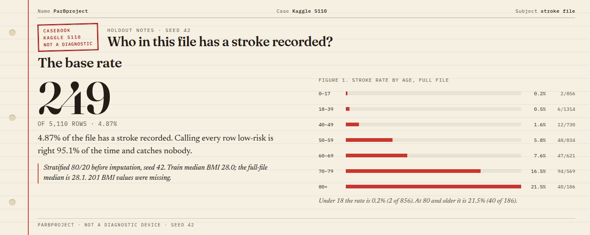
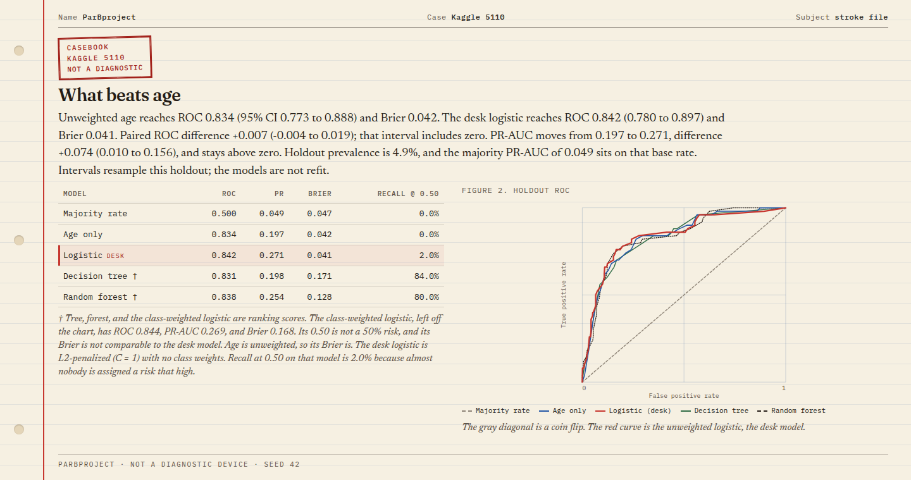
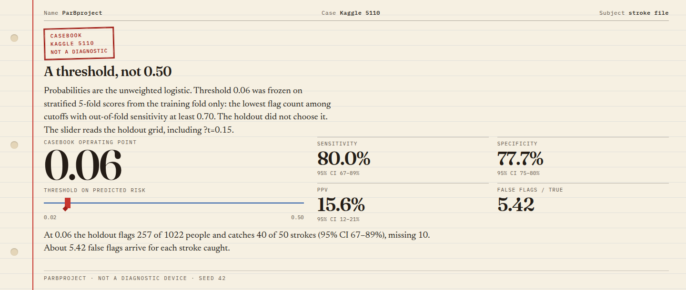
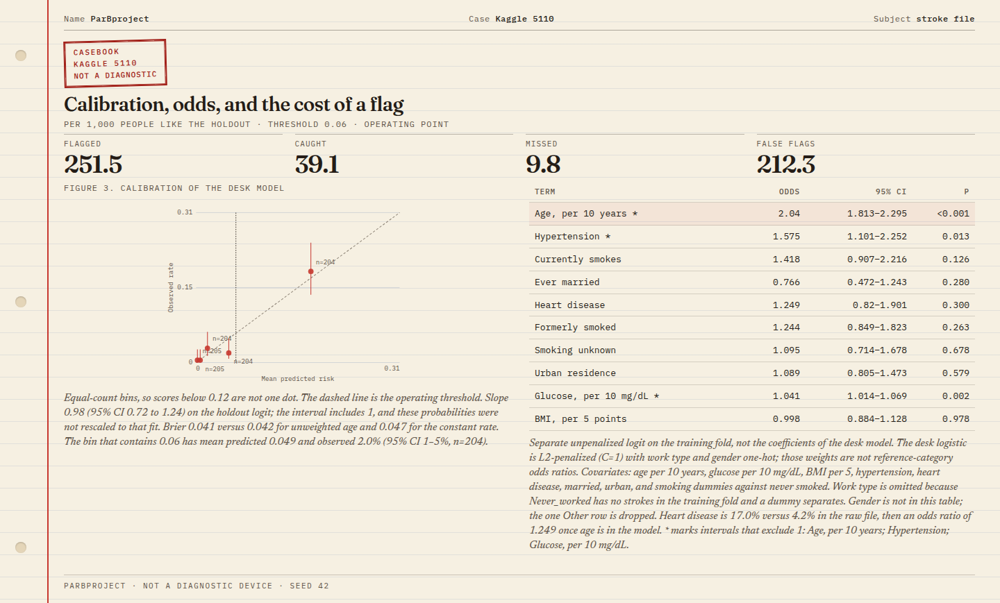

# Stroke casebook

Holdout notes on the [Kaggle stroke prediction file](https://www.kaggle.com/datasets/fedesoriano/stroke-prediction-dataset): 5,110 rows, 249 strokes. The page is a notebook for this file. It is not a diagnostic tool.

**[Open the casebook](https://parbproject.github.io/Stroke/)**

## Question

Can a simple model flag rows with a recorded stroke, without treating accuracy or a 0.50 cutoff as a risk?

## Data

| | |
|---|---|
| File | `healthcare-dataset-stroke-data.csv`, committed 2025-09-08 |
| Source | [Stroke Prediction Dataset](https://www.kaggle.com/datasets/fedesoriano/stroke-prediction-dataset) by fedesoriano, Kaggle, updated 2021-01-26 |
| Shape | 5,110 rows, 12 columns; 201 missing BMI values |
| Check | SHA-256 `644d473b05d2797006bd94865e4f8bb057f0c721617911613c82c8fcfc707420`; 316,971 bytes, the size Kaggle lists |
| Where the rows came from | Not documented. Kaggle says "Confidential Source" |
| Terms | Kaggle: "Data files © Original Authors", educational use, credit the author. Used here as a casebook only |
| Limit | Population, dates, and what "stroke" means in the file are unknown. These numbers do not transfer to a clinic |

## Method

Split first: stratified 80/20, seed 42, before imputation, scaling, or encoding. Missing BMI is filled with the training median (28.0) inside the pipeline. The full-file median is 28.1 and is not used. The training fold is not resampled.

| Role | Model |
|---|---|
| Baseline | Training prevalence, the same score on every row |
| Baseline | Age-only logistic, unweighted |
| Desk model | L2 logistic, C = 1, no class weights. Calibration, Brier, and the threshold use these probabilities |
| Comparison | Decision tree, depth 4, minimum leaf 40, class-weighted |
| Comparison | Random forest, 300 trees, depth 8, minimum leaf 20, balanced subsample |

A class-weighted logistic is fit only as a ranking check. Its scores are not risks, and 0.50 on that model is not a 50% chance.

ROC-AUC is the ranking number. PR-AUC is the rare-event number: the majority model's PR-AUC sits on the holdout base rate, about 4.9%. Intervals on those two, and on Brier, are a paired percentile bootstrap of the holdout rows (2,000 resamples, seed 42). The fitted models are not refit inside the bootstrap. Sensitivity, specificity, and PPV use Wilson intervals on the holdout counts.

The threshold is chosen on the training fold. Stratified 5-fold out-of-fold probabilities from the unweighted logistic are swept from 0.02 to 0.50. The cutoff is the one that flags the fewest rows among those with out-of-fold sensitivity at least 0.70. The logistic is then refit on the full training fold and that cutoff is applied once to the holdout. The slider, including `?t=0.15`, only reads the holdout grid.

Odds ratios are a separate unpenalized logit on the training fold (age per 10 years, glucose per 10 mg/dL, BMI per 5, hypertension, heart disease, married, urban, smoking). They are not the desk model's coefficients. That model is L2-penalized and one-hot encodes work type and gender with no reference level. `gender == Other` is dropped, and gender is not in the association model. Work type is left out because `Never_worked` has no strokes in the training fold, so a dummy separates.

## Holdout

From `casebook/metrics.json`, seed 42.

- Prevalence 4.87% (249 / 5,110). Scoring every row as low-risk is right about 95.1% of the time and catches no strokes. Majority recall at 0.50 is 0.
- Stroke rate is 0.2% under 18 (2 / 856) and 21.5% at 80 and older (40 / 186).
- ROC-AUC: majority 0.500, age only 0.834 (95% bootstrap CI 0.773–0.888), desk logistic 0.842 (0.780–0.897), tree 0.831, forest 0.838. Desk minus age is +0.007 (−0.004 to +0.019). That interval includes zero.
- PR-AUC: majority 0.049, age only 0.197, desk logistic 0.271, forest 0.254. Desk minus age is +0.074 (0.010–0.156).
- Brier: desk logistic 0.041, unweighted age 0.042, majority 0.047. Desk minus age is −0.001 (−0.003 to 0.000). The fuller model does not beat age as a probability. The class-weighted logistic has Brier 0.168 and ROC 0.844.
- Calibration slope of the desk probabilities, fit on the holdout as a check, is 0.981 (95% CI 0.722–1.24). The probabilities are not rescaled. The diagram uses five equal-count bins.
- Operating threshold 0.06, from training out-of-fold scores (sensitivity 0.7337, specificity 0.7701, PPV 0.1404, 1,040 of 4,088 training rows flagged). On the holdout: sensitivity 0.80 (40 / 50; Wilson 95% CI 0.67–0.89), specificity 0.7767 (0.75–0.80), PPV 0.1556 (0.12–0.21), 5.42 false flags per true stroke.
- Per 1,000 holdout-like rows, that threshold flags 251.5, catches 39.1, misses 9.8, and raises 212.3 false flags.
- The same rule on the holdout gives 0.11 (sensitivity 0.70, specificity 0.8714, PPV 0.2188, 3.57 false flags per true stroke; per 1,000: flagged 156.6, caught 34.2, missed 14.7, false flags 122.3). That uses the evaluation labels, so it is not the operating point.
- Age odds ratio 2.04 per 10 years (95% CI 1.81–2.30). Hypertension 1.58. Glucose 1.04 per 10 mg/dL. BMI, after age, is about 1.00.

## Page

The screenshots are the current page.









`casebook/index.html` is the page. The repository root redirects there and keeps `?shot=` and `?t=`. `?t=0.15` pins a threshold. `?shot=open|models|point|burden` shows one section.

## Run

```bash
python3 -m pip install -r requirements.txt
PYTHONHASHSEED=42 OPENBLAS_NUM_THREADS=1 OMP_NUM_THREADS=1 MKL_NUM_THREADS=1 python3 -m casebook.analyze
pytest -q
python3 -m http.server
```

Then open `http://127.0.0.1:8000/`. Pins are in `requirements.txt` (pandas 3.0.6, numpy 2.5.3, scikit-learn 1.9.1, scipy 1.18.1, statsmodels 0.15.0, pytest 9.1.1). CI uses the same thread limits.

`archive/Build-deploy-stroke-prediction-model-R.Rmd` is an earlier pass. It fills medians before the split and picks a model by holdout AUC. It is not re-run, and the closing write-up that used to name a winning model is gone. The Python casebook is the analysis.

## Disclaimer

Educational notes on a public Kaggle file. Not a diagnostic device, and not checked for clinical use.
